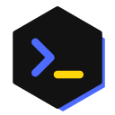

# agentbox

One container per coding-agent session, on a remote Docker host managed by [DevPod](https://devpod.sh). Each session gets its own clone of a workspace repo; you reach it over SSH straight into the container.

agentbox is two things:

- **A devcontainer Feature**, `ghcr.io/novibe-org/agentbox/agentbox`: sshd, helix, yazi, lazygit, delta, ripgrep, and the mounts that share session state across containers.
- **A CLI**, `bin/agentbox`, that creates, opens, lists and deletes sessions from your machine.

## Isolation

Sessions are isolated from each other and from your laptop, not from your accounts. Every session sees the same Claude Code login, GitHub login and git identity, and your SSH agent is forwarded in. An agent in a session can push wherever you can.

## Setup at a glance

1. [Create a session host](#the-session-host), for example [on Hetzner](#a-host-on-hetzner).
2. [Install the CLI](#the-cli) and point it and SSH at the host.
3. [Make a workspace repo](#a-workspace) whose devcontainer uses the Feature.
4. `agentbox new <id> <owner/workspace>`, then [log in once](#log-in-once).

## The session host

Any x86_64 Docker host registered as a DevPod machine. Shared state lives under `/home/devpod` on the host, owned by uid 1000, and is mounted into every session:

| Host                         | Container             | Holds                    |
| ---------------------------- | --------------------- | ------------------------ |
| `/home/devpod/claude-config` | `/agentbox/claude`    | Claude Code login, settings |
| `/home/devpod/gh-config`     | `/agentbox/gh`        | GitHub CLI login         |
| `/home/devpod/git-config`    | `/agentbox/git`       | git identity (`config`)  |
| `/home/devpod/pnpm-store`    | `/agentbox/pnpm-store`| pnpm package store       |

`agentbox new` creates these directories if they are missing. The container user must be uid 1000, as `node` is in the Node images.

The CLI reaches the host as `ssh $AGENTBOX_MACHINE`, so that name must work as an SSH host on its own.

### A host on Hetzner

The [Hetzner provider](https://github.com/mrsimonemms/devpod-provider-hetzner) creates a server with a separate volume mounted at `/home/devpod`. Session clones and the shared logins live on that volume; containers and images live on the server's own disk.

```bash
devpod provider add mrsimonemms/devpod-provider-hetzner --name hetzner \
  -o TOKEN=<hetzner-cloud-api-token> \
  -o REGION=nbg1 \
  -o MACHINE_TYPE=cpx32 \
  -o DISK_SIZE=50 \
  -o INACTIVITY_TIMEOUT=8760h \
  -o INJECT_GIT_CREDENTIALS=false
devpod machine create agent-host --provider hetzner
```

| Option                         | Why                                                                                         |
| ------------------------------ | ------------------------------------------------------------------------------------------- |
| `MACHINE_TYPE=cpx32`           | 4 vCPU, 8 GB: room for a few sessions running installs and tests at once. Size up for more. |
| `DISK_SIZE=50`                 | The `/home/devpod` volume: every session's clone, `node_modules` and the pnpm store.        |
| `INACTIVITY_TIMEOUT=8760h`     | The default `10m` stops the machine while agents are still working. This is effectively never. |
| `INJECT_GIT_CREDENTIALS=false` | Sessions use the forwarded SSH agent and the shared `gh` login instead.                     |

Then give the host a name SSH knows. The key is the one DevPod generated for the machine; the address is in the Hetzner console or `hcloud server list`.

```
Host agent-host
  HostName <server-ip>
  User devpod
  IdentityFile ~/.devpod/contexts/default/machines/agent-host/id_devpod_rsa
  IdentitiesOnly yes
  ControlMaster auto
  ControlPath ~/.ssh/cm/%r@%h:%p
  ControlPersist 30m
  ServerAliveInterval 20
```

`ControlMaster` matters: every `<id>.agentbox` connection hops through this host, and reusing one connection makes opening a session near instant. Create the socket directory once with `mkdir -p ~/.ssh/cm`.

## A workspace

A workspace is a git repo whose `.devcontainer` uses the Feature and clones the projects it works on:

```jsonc
// .devcontainer/devcontainer.json
{
  "name": "myworkspace",
  "image": "mcr.microsoft.com/devcontainers/typescript-node:22",
  "runArgs": ["--restart=unless-stopped"],
  "features": {
    "ghcr.io/anthropics/devcontainer-features/claude-code:1": {},
    "ghcr.io/devcontainers/features/github-cli:1": {},
    "ghcr.io/novibe-org/agentbox/agentbox:1": {}
  },
  "postCreateCommand": "bash .devcontainer/setup.sh"
}
```

```bash
# .devcontainer/setup.sh
set -euo pipefail
for repo in app plugins; do
  [ -d "projects/$repo/.git" ] || git clone "git@github.com:myorg/$repo.git" "projects/$repo"
done
(cd projects/app && pnpm install --frozen-lockfile)
```

`agentbox rm` checks the workspace repo and every repo under `projects/` for unpushed work before deleting.

Good habits for a workspace repo:

- **Restart with the host**: `runArgs: ["--restart=unless-stopped"]`, as above, brings sessions back after the host or Docker restarts.
- **Ignore `projects/`** in its `.gitignore`. The cloned repos stay independent; `git add projects/` would turn them into gitlinks.
- **Keep `setup.sh` idempotent**: guard each clone, as above, so a rebuild doesn't fail on what is already there.
- **Install from lockfiles** (`--frozen-lockfile`, `npm ci`). With the shared pnpm store, a second session installs mostly from cache.
- **Check in `.claude/settings.json`** with the plugins and marketplaces the sessions need, so every session starts with the same Claude Code setup.
- **Add a `CLAUDE.md`** that names the repos under `projects/` and what each is for.

## The CLI

Put `bin/agentbox` on your `PATH`, tell it which machine hosts sessions, and add this to `~/.ssh/config`:

```bash
export AGENTBOX_MACHINE=agent-host
```

```
Host *.agentbox
  User node
  ProxyCommand agentbox proxy %h
  ForwardAgent yes
  StrictHostKeyChecking no
  UserKnownHostsFile /dev/null
  LogLevel error
```

`<id>.agentbox` goes straight into the session's container through the host, bypassing DevPod's slower SSH path.

Name the workspace repo, or run from inside a checkout of it:

```bash
agentbox new fix-login myorg/workspace   # create a session and open it
agentbox new fix-login                   # same, from this directory's origin
agentbox open fix-login  # reconnect
agentbox ls
agentbox rm fix-login
```

`open` uses [cmux](https://cmux.dev) when run inside it, plain `ssh` otherwise.

### Configuration

| Variable           | Default                   | Meaning                                                                  |
| ------------------ | ------------------------- | ------------------------------------------------------------------------ |
| `AGENTBOX_MACHINE` | (required)                | DevPod machine, and SSH host, that runs the sessions                     |
| `AGENTBOX_REPO`    | this directory's `origin` | Workspace repo for `new`: a git URL, `owner/name` or `owner/name@branch` |
| `AGENTBOX_PUBKEY`  | `~/.ssh/id_ed25519.pub`   | Public key authorized in each new session                                |

`AGENTBOX_PUBKEY` must match the key SSH offers to `*.agentbox`. If you use another key, set both the variable and an `IdentityFile` with `IdentitiesOnly yes` in the `*.agentbox` block.

Some tools run `ProxyCommand` without your shell profile. If `AGENTBOX_MACHINE` comes from `~/.zshrc`, put it in the proxy line too: `ProxyCommand env AGENTBOX_MACHINE=agent-host agentbox proxy %h`.

## Log in once

The logins live on the host, not in the container, so the first session sets them up for every later one:

```bash
claude                                   # log in to Claude Code
gh auth login                            # log in to GitHub
git config --global user.name  "Your Name"
git config --global user.email "you@example.com"
```

Deleting a session keeps them; only deleting the directories under `/home/devpod` on the host removes them.

## cmux

cmux opens links clicked in the terminal in its own browser. To open them in your Mac's browser instead, while keeping the session's forwarded dev servers in cmux, add this to `~/.config/cmux/cmux.json` and reload with ⌘⇧,:

```jsonc
"browser": {
  "hostsToOpenInEmbeddedBrowser": ["localhost", "*.localhost", "127.0.0.1", "::1", "0.0.0.0"]
}
```

Set `"openTerminalLinksInCmuxBrowser": false` instead to send every link out, localhost included.

## Best practices

- **One session per task.** Name it after the task (`fix-login`) and `agentbox rm` it once the work is merged. Sessions are cheap; a stale one still holds a clone and a container.
- **Push before you leave a session.** `rm` refuses to delete unpushed work, but losing the host loses it.
- **Let agents push branches, not `main`.** They act with your accounts; branch protection on your repos is the guard rail.
- **Rebuild instead of repairing.** If a session's environment drifts, `agentbox rm` and `agentbox new` with the same id start clean from the workspace repo.
- **Bring a stopped session back** with `devpod up <id> --ide none`, then `agentbox open <id>`. Sessions without the restart policy stay down after the host reboots.
- **Watch the disk.** `ssh agent-host df -h /home/devpod` shows the volume; `docker system prune` on the host clears old images after Feature updates.
